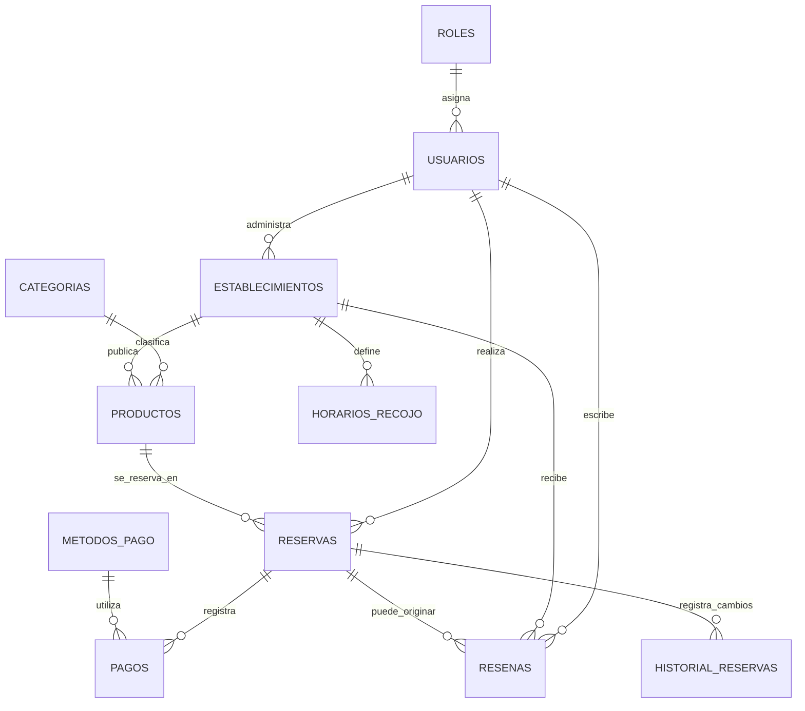

# Modelo relacional de FoodxEver (tercer avance)

La base de datos contiene **11 tablas**. Las tablas de operación se usan desde los módulos de la aplicación; las tablas auxiliares normalizan catálogos y guardan datos que se necesitan para extender las reservas sin rediseñar el proyecto.

| N.º | Tabla | Propósito y relaciones |
|---:|---|---|
| 1 | `roles` | Catálogo de roles. Un rol puede estar asignado a muchos usuarios. |
| 2 | `usuarios` | Cuentas registradas; referencia a `roles`. Puede vincularse a reservas y ser propietario de un establecimiento. |
| 3 | `establecimientos` | Locales que publican productos; puede referenciar a un usuario propietario. |
| 4 | `categorias` | Categorías de alimentos y tipo de establecimiento compatible. |
| 5 | `productos` | Precio, stock, imagen, horario, estado; referencia a `categorias` y `establecimientos`. |
| 6 | `reservas` | Cliente, producto reservado, cantidad, total, estado y fecha; referencia a `productos` y, cuando existe sesión, a `usuarios`. |
| 7 | `metodos_pago` | Catálogo de métodos de pago disponibles. |
| 8 | `pagos` | Importe, método y estado de pago; referencia a `reservas` y `metodos_pago`. |
| 9 | `resenas` | Calificación y comentario; referencia a `usuarios`, `establecimientos` y opcionalmente a `reservas`. |
| 10 | `historial_reservas` | Registro cronológico del estado anterior y nuevo de cada reserva. Se añade al crear o cambiar el estado. |
| 11 | `horarios_recojo` | Días y horas de recojo por establecimiento. |

## Relaciones principales

## Consultas DTO de la demostración

1. `ProductoEstablecimientoDTO`: une `productos`, `categorias` y `establecimientos` para listar producto, categoría, local, dirección, precio, stock y recojo.
2. `ReservaResumenDTO`: une `reservas`, `productos` y `establecimientos` para listar cliente, artículo reservado, local, cantidad, total, estado y fecha.

Ambas aparecen en `/consultas` y admiten filtrar por establecimiento.

## Nota de alcance

La interfaz incorpora CRUD para diez tablas: usuarios, roles, establecimientos, categorías, productos, reservas, métodos de pago, pagos, reseñas y horarios de recojo. La undécima tabla, `historial_reservas`, es una bitácora automática de auditoría y se consulta en modo de solo lectura. Las restricciones de integridad impiden eliminar registros que todavía estén relacionados con datos operativos.

## Operaciones administrativas

El panel `/administracion` añade operaciones CRUD para roles, usuarios, categorías, métodos de pago y horarios de recojo. Sumadas a los CRUD existentes de establecimientos, productos, reservas, pagos y reseñas, quedan diez tablas gestionables mediante la interfaz. La undécima tabla (`historial_reservas`) se presenta en `/administracion/historial` en modo de consulta: los movimientos se generan automáticamente y no se editan ni eliminan manualmente.
